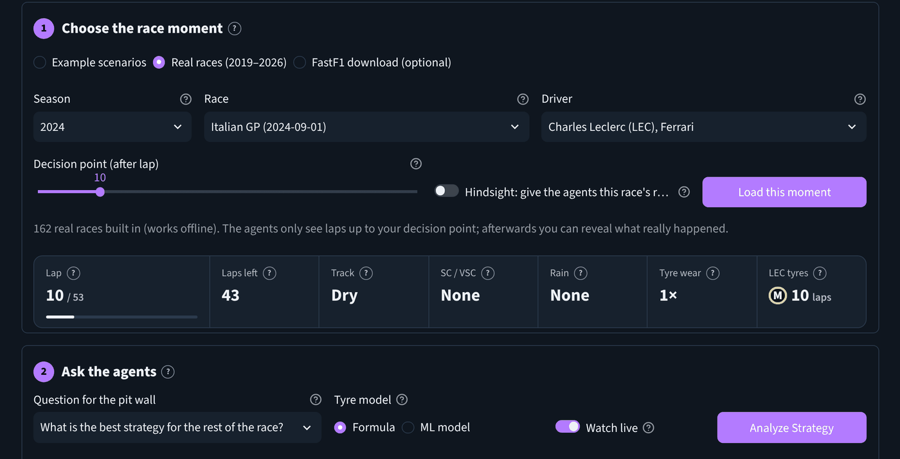
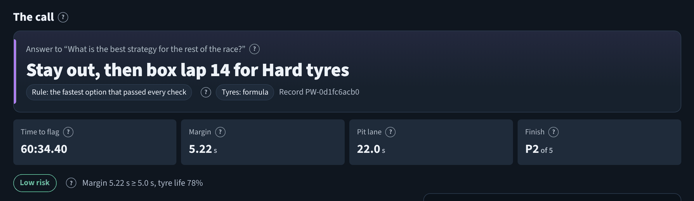
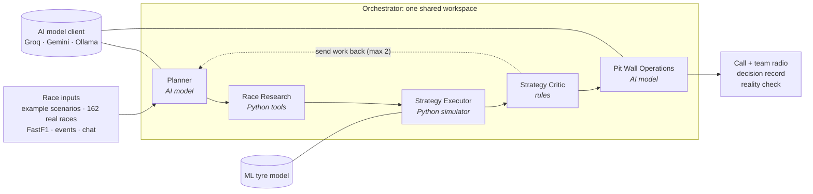
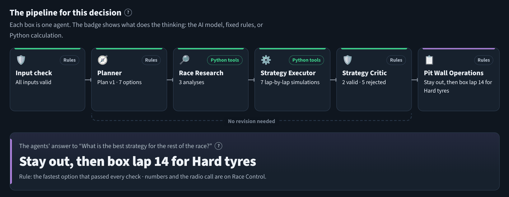
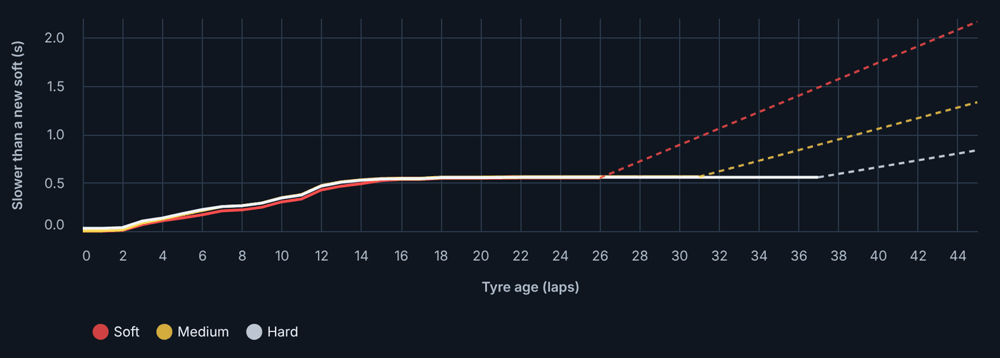
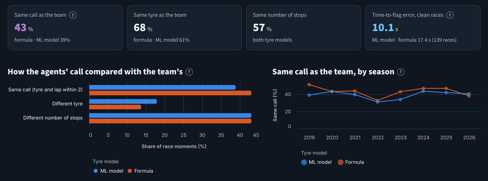

# PitWall AI

**Five AI agents that make the Formula 1 pit-stop call, and show their work.**

PitWall AI is a proof of concept for agentic AI. Five agents share one workspace to answer the pit wall's
question: *box now, box later or stay out, and on which tyres?* An AI model plans and decides, a Python
simulator calculates every lap time, and a rule-based Critic checks every plan before anything is recommended.
You can run it on example scenarios, on 162 real races (2019 → Singapore 2026) built into the project, or on any
race downloaded with FastF1, then reveal what the real team did.



## What it does

- **Makes the call.** Pick a race moment and press **Analyze Strategy**. You get the strategy, time to the flag,
  margin over the next option, projected finish, a risk rating and a team-radio message.
- **Shows every step.** The Agents page shows each agent working live: what it was given, what it did, what it
  decided and what it passed on.
- **Checks itself against history.** For real races, *Reveal what really happened* compares the agents' call with
  the team's real strategy, without leaking any later lap into the decision.
- **Takes "what if" questions.** One-click Safety Car, VSC, rain or tyre-wear events, or a whole scenario typed into
  the chat ("after lap 20 of 56 on 18-lap-old mediums, VSC on laps 24–26, rain from lap 35 to 45").
- **Learns tyre wear from data.** An optional machine-learning tyre model trained on 139,025 real laps.



## How it works



| Agent | Brain | Job | Guard rail |
|---|---|---|---|
| Planner | AI model | Decides which pit-stop plans to test, including its own | Unknown tyres dropped; "stay out" and "box now" always tested |
| Race Research | Python | Measures tyres, gaps, weather and track status | Pure calculation |
| Strategy Executor | Python simulator | Simulates every plan lap by lap to the flag | The AI never produces a lap time |
| Strategy Critic | Rules | Checks racing rules and every number; can send work back | Deliberately not AI; at most 2 revisions |
| Pit Wall Operations | AI model | Chooses the call, explains it, writes the radio | Only Critic-approved options within 2 s of the fastest |

**The AI proposes, Python calculates, the rules check.** The default AI model is OpenAI's open-weight
`gpt-oss-120b` on Groq's free plan. If it's missing, slow or gives an unusable answer, each agent falls back to its
rules and the activity log says so, so the app never depends on the AI to work.



## Results (measured)

**ML tyre model.** Trained on 2019–2024, tested on 40 races from 2025–2026 it never saw:

| Average lap-time error | ML model | Hand-written formula | No model |
|---|---|---|---|
| All tyres | **0.559 s** | 0.704 s | 0.792 s |
| Soft / Medium / Hard | 0.634 / 0.530 / 0.558 s | 1.084 / 0.671 / 0.603 s | – |

That is 21% lower than the formula. R² is 0.44 (formula 0.03): lap times are noisy, so the model explains under
half of the lap-to-lap variation.



**Agents vs real teams.** 406 real moments (the P1, P5 and P10 finishers of each race, 3 laps before their first
real stop):

| | Formula tyres | ML tyres |
|---|---|---|
| Same call as the team | 43% | 39% |
| Same tyre as the team | 68% | 61% |
| Time-to-flag error, 139 clean races (median) | 17.4 s | 10.1 s |

Agreement is a sanity check, not a score: real teams know tyre temperatures and rivals' plans. The shipped ML
model is trained on every season, so only 2025–26 is a fully fair test for it here.



## Run it on your computer

Needs Python 3.12 or 3.13. On Windows, open Command Prompt in the project folder:

```bat
py -3.13 -m venv .venv
.venv\Scripts\activate
python -m pip install --upgrade pip
pip install -r requirements.txt -r requirements-optional.txt
python -m pytest
streamlit run app.py
```

On macOS or Linux, use `python3 -m venv .venv` and `source .venv/bin/activate` instead of the first two lines.
Open http://localhost:8501 and stop with `Ctrl+C`. `requirements-optional.txt` adds FastF1; leave it out if you only
want the built-in races.

### Switch on the AI model (free)

1. At **console.groq.com**, open **API Keys → Create API Key** and copy the key (it starts with `gsk_`).
2. Copy `.streamlit/secrets.toml.example` to `.streamlit/secrets.toml` and paste the key:
   `GROQ_API_KEY = "gsk_..."`
3. Restart the app. The header shows **AI: openai/gpt-oss-120b**.

Google Gemini (`GEMINI_API_KEY`) works the same way. Keys are only read from `secrets.toml`, a `.env` file or
environment variables, never typed on the page, and both files are git-ignored. Visitors can switch the AI off on
the **Model Lab** page to compare it with the rules.

### Use FastF1

On **Race Control → Choose the race moment**, pick **FastF1 download**, choose a season and race and press
**Download race timing**. The first download of a race takes a minute or two and is then cached in
`data/fastf1_cache`. Choose the driver and lap, press **Use this moment**, then **Analyze Strategy**.

## Deploy

The app runs on an AWS EC2 server with Docker, and every push to `main` updates it automatically through GitHub
Actions (tests first, then deploy). Step by step: **[DEPLOY_AWS.md](DEPLOY_AWS.md)**.

## The pages

| Page | What it's for |
|---|---|
| **Race Control** | Pick a race moment, choose the tyre model, analyze, reveal what really happened |
| **Agents** | The five agents working live, each agent's inputs and decisions, every AI call, the activity log |
| **Ask the Pit Wall** | Chat: ask why, compare options, or describe a whole scenario |
| **Strategy Lab** | One-click race events with before/after comparison; every option tested |
| **Model Lab** | AI model status, the ML tyre model, agents vs real teams |
| **Race Setup** | Every input, editable, with where each value came from |
| **Records** | Saved decision records, KPIs, JSON/CSV downloads |
| **About** | Architecture, lap-time model, Critic rules, limits |

## Project layout

```
app.py                     entry point: top navigation + header
views/                     one file per page
ui/                        page layouts, components, charts, styles, session state
pitwall/agents/            the five agents, chat assistant, AI brief and validation
pitwall/llm.py             AI model client (Groq / Gemini / Ollama), standard library only
pitwall/ml/tyre_model.py   ML tyre model: dataset, training, evaluation, curves
pitwall/orchestrator.py    shared workspace, routing, bounded revision loop
pitwall/simulation.py      lap-time model, constraints, positions
pitwall/config.py          model parameters and assumptions
pitwall/data_sources/      example scenarios, built-in real races, FastF1
data/                      real races, ML model, evaluation results
scripts/                   retrain the ML model, rerun the evaluation, rebuild the race data
tests/                     193 pytest tests, incl. headless page tests and a stand-in AI server
deploy/aws/, Dockerfile    server setup and deployment
.github/workflows/         test and deploy on every push
```

## Tests

```bash
python -m pytest
```

193 tests cover the simulation, the Critic's rules, the revision loop, no hindsight leakage, AI failure handling
(with a local stand-in AI server, no real key needed), the ML model and every page. They run on every push.

## Limits

A proof of concept that replays history: no live timing, no overtaking, DRS or tyre-temperature physics, and
Safety Cars and rain are given (or taken from the real race on request), never predicted. Lap time = base pace +
tyre effect + weather + traffic + fuel/track effect + Safety Car/VSC slow-down; all assumptions are in
`pitwall/config.py`.

## Data and credits

- **Built-in races:** FastF1-derived timing from the [TracingInsights](https://github.com/TracingInsights) archive
  (MIT licence). See `data/replays/index.json` for the list.
- **[FastF1](https://docs.fastf1.dev):** downloads race timing on demand.
- **AI model:** OpenAI `gpt-oss-120b` served by [Groq](https://console.groq.com).
- **ML:** scikit-learn `HistGradientBoostingRegressor`.

PitWall AI is an educational project and is not affiliated with Formula 1, the FIA or any team.
